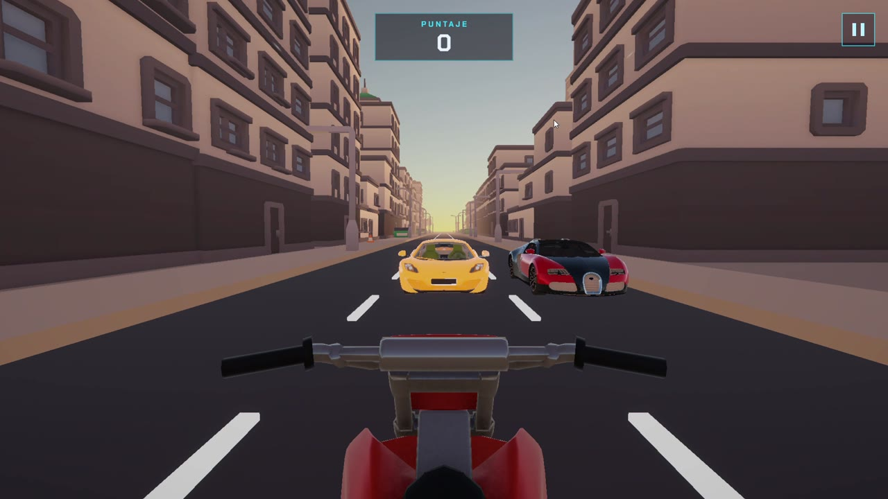
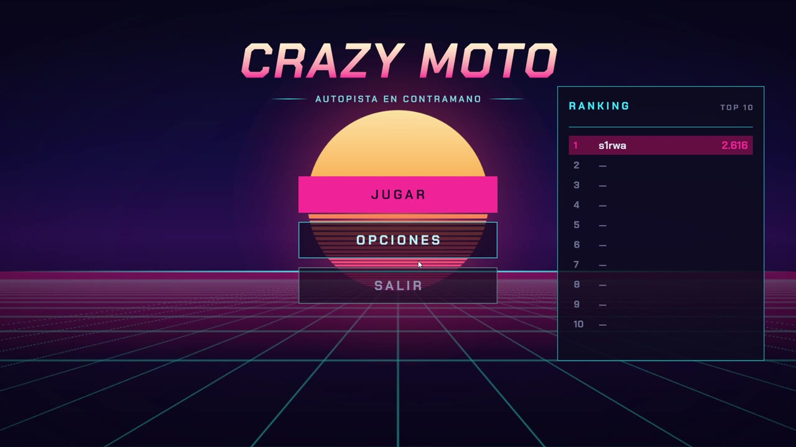
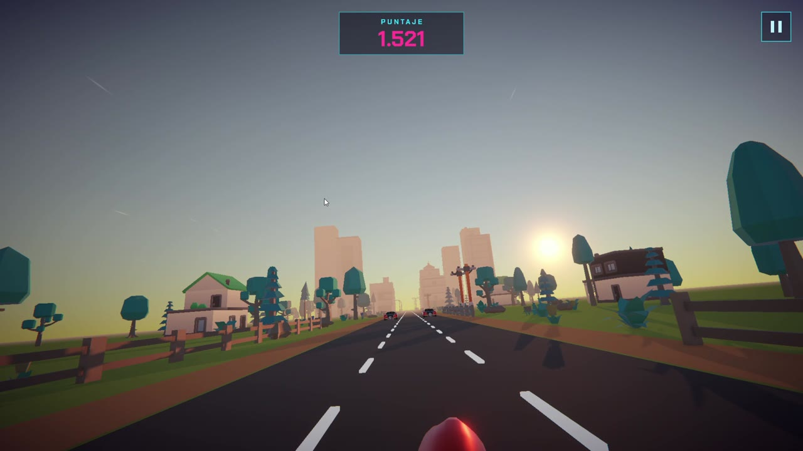
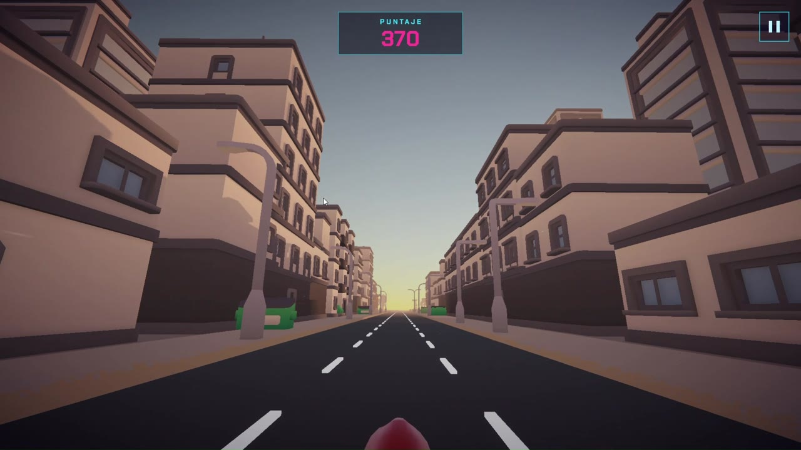
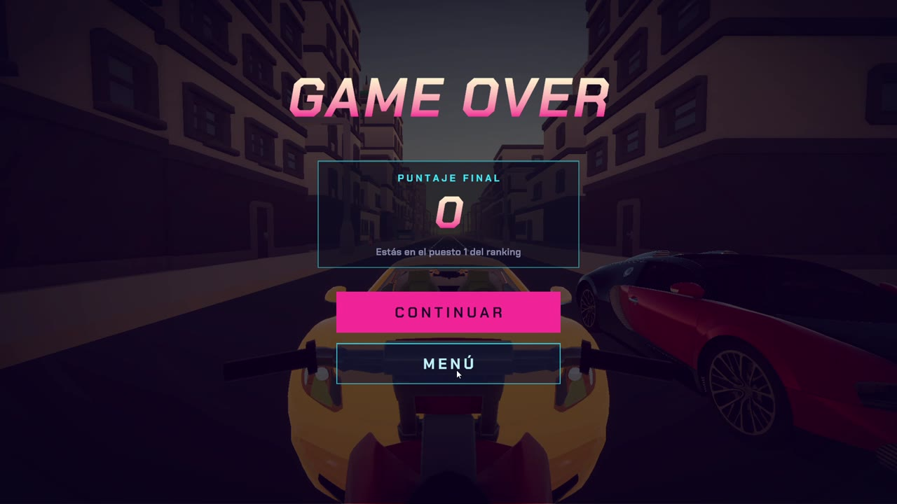
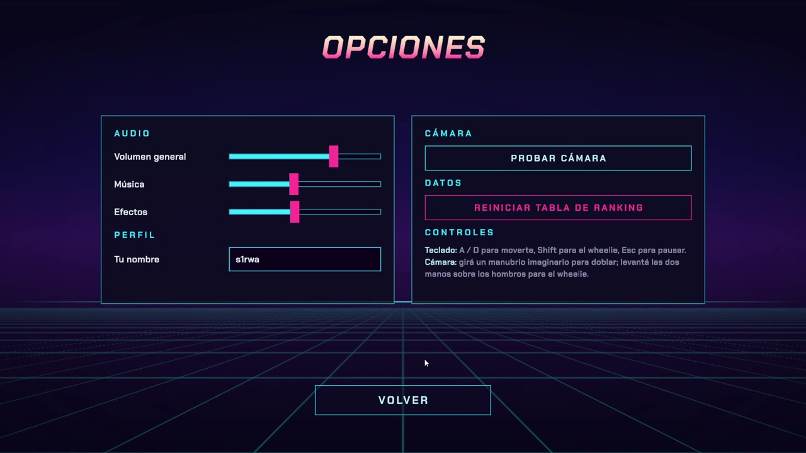
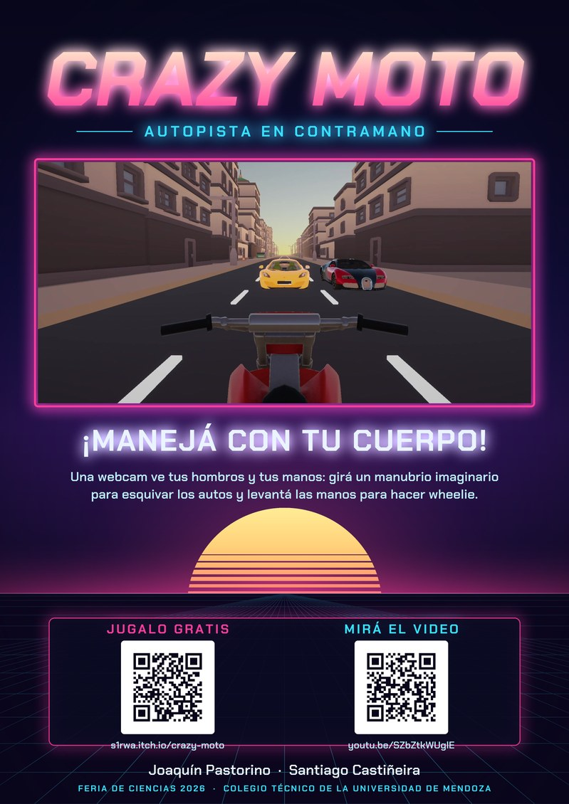
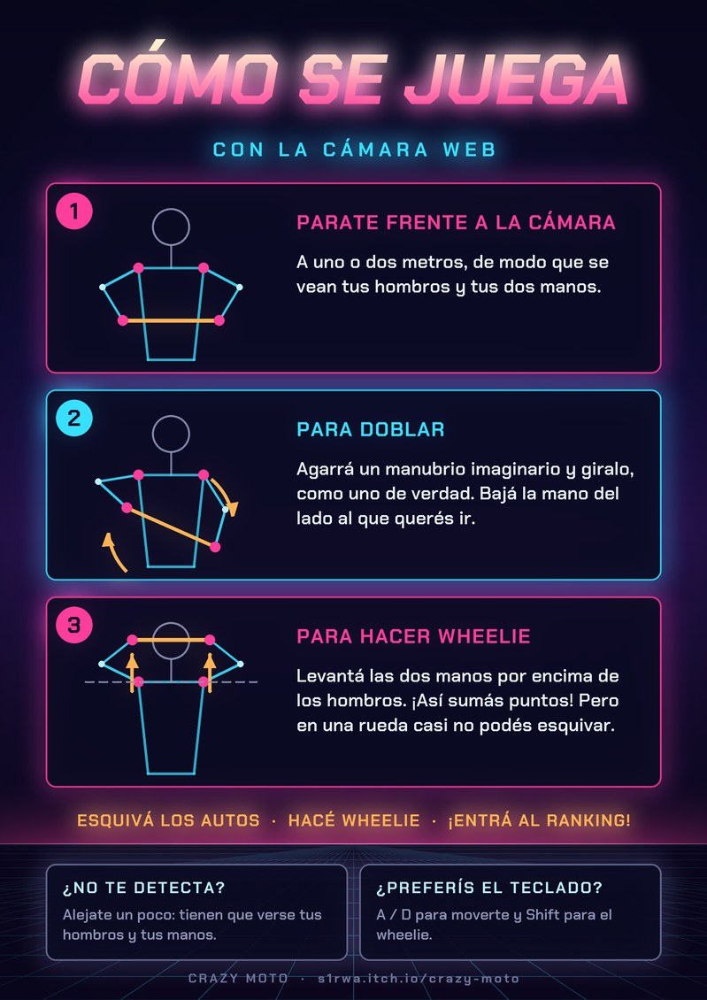

# 🏍️ Crazy Moto

[](https://unity.com/releases/editor/archive)
[](https://docs.unity3d.com/Packages/com.unity.render-pipelines.universal@17.5/manual/index.html)
[](https://www.python.org/downloads/)
[](https://ai.google.dev/edge/mediapipe/solutions/guide)
[](#)

> Endless-runner de moto en 3D. Proyecto integrador para la **Feria de Ciencias**.
> Se juega con el teclado… **o moviendo las manos frente a la webcam**, como si
> agarraras un manubrio de verdad.



---

## ⬇️ Descargar y jugar

**[🎮 Crazy Moto en itch.io](https://s1rwa.itch.io/crazy-moto)** — página del juego, se baja gratis.

**[▶️ Video en YouTube](https://youtu.be/SZbZtkWUglE)** — 1:40 con cómo se juega y cómo funciona el control por cámara.

**[📁 Carpeta del juego en Google Drive](https://drive.google.com/drive/folders/1uzdDwrgAJaFdZmjhe8o6fqzH9Q4M7_rZ?usp=drive_link)** — el mismo build de Windows, listo para jugar.

1. Bajá el `.zip` de itch.io, o la **carpeta entera** de Drive (clic derecho →
   *Descargar*, también baja un `.zip`). No alcanza con el `.exe`: necesita los
   archivos que tiene al lado.
2. Descomprimí el `.zip` y abrí **`Crazy Moto.exe`**.
3. Si Windows muestra *"Windows protegió su PC"*, tocá **Más información → Ejecutar
   de todas formas** (pasa con cualquier juego que no está firmado).

Requisitos: Windows 10 u 11 de 64 bits. Se juega con el teclado; para el control
por cámara web hace falta además el detector (ver el [paso 5](#paso-5-opcional--control-por-cámara-web-)).

---

## 🎬 Video

[](https://youtu.be/SZbZtkWUglE)

En 1:40: de qué trata el juego, el wheelie, cómo funciona el control por cámara y
el problema que tuvimos que resolver. El guion, las animaciones y el montaje
están en [`video/`](video/).

---

## 🎮 De qué trata

Avanzás por una autopista **en contramano**, esquivando autos que vienen de frente
por tres carriles. Para sumar puntos tenés que sostener el **wheelie** (la rueda
delantera arriba), pero mientras lo hacés casi no podés moverte de costado: ahí
está el riesgo. El juego se va acelerando solo, así que cada vez es más difícil, y
cuanto más rápido vas, más puntos da el wheelie.

Cuando chocás, se termina la partida y tu puntaje entra al **ranking**, que se
guarda en disco y se ve en el menú (Top 10 + en qué puesto quedaste).

---

## 📸 Capturas

<table>
  <tr>
    <td><br><sub>El menú, con el ranking Top 10.</sub></td>
    <td><br><sub>Autopista en contramano: dos autos de frente.</sub></td>
  </tr>
  <tr>
    <td><br><sub>El campo al atardecer (se alterna con la ciudad).</sub></td>
    <td><br><sub>En wheelie: el puntaje se pone magenta mientras suma.</sub></td>
  </tr>
  <tr>
    <td><br><sub>Game Over, con el puntaje final y el puesto en el ranking.</sub></td>
    <td><br><sub>Opciones: volumen, nombre, probar la cámara y controles.</sub></td>
  </tr>
</table>

---

## 🖼️ Carteles del stand

Para la feria hay un póster A3 y un cartel A4 con las instrucciones de la cámara,
listos para imprimir (detalles y propuesta de armado del stand en
[`decoracion/`](decoracion/)).

<table>
  <tr>
    <td width="50%"><a href="decoracion/render/poster-a3.pdf"></a><br><sub><a href="decoracion/render/poster-a3.pdf">Póster A3 (PDF)</a></sub></td>
    <td width="50%"><a href="decoracion/render/instrucciones-a4.pdf"></a><br><sub><a href="decoracion/render/instrucciones-a4.pdf">Instrucciones A4 (PDF)</a></sub></td>
  </tr>
</table>

---

## 🕹️ Controles

Hay **dos formas de jugar**, y funcionan las dos al mismo tiempo. Si el control
por cámara está andando manda la cámara; si no, manda el teclado.

| Acción | ⌨️ Teclado | 📷 Cámara web |
|---|---|---|
| Mover a la izquierda | `A` o `←` | Girás el manubrio imaginario: bajás la mano **izquierda** |
| Mover a la derecha | `D` o `→` | Girás el manubrio imaginario: bajás la mano **derecha** |
| Wheelie (sumar puntos) | Mantener `Shift` | Levantás **las dos manos** por encima de los hombros |
| Pausa | `Esc` | — (usá el botón `II` del HUD) |

Con la cámara agarrás un manubrio imaginario con las dos manos, delante del pecho,
y lo girás como uno de verdad. Para el wheelie, levantás las dos manos como si
tiraras del manubrio para arriba. No hace falta calibrar: te podés correr,
acercar o alejar de la cámara y el gesto se lee igual.

---

## ⚙️ Abrir el proyecto en Unity

Esto es para ver o modificar el código. Para jugar alcanza con
[la carpeta de Drive](https://drive.google.com/drive/folders/1uzdDwrgAJaFdZmjhe8o6fqzH9Q4M7_rZ?usp=drive_link).

### Paso 1 — Instalar Unity

1. Bajá e instalá el **[Unity Hub](https://unity.com/download)**.
2. Dentro del Hub, andá a **Installs → Install Editor** e instalá la versión
   **`6000.5.8f1`** (Unity 6.5).
   Si no aparece en la lista, buscala en el
   [archivo de versiones](https://unity.com/releases/editor/archive).

> ⚠️ Tiene que ser esa versión. Con una más nueva Unity te va a pedir actualizar
> el proyecto y puede romper cosas.

### Paso 2 — Bajar el proyecto

```bash
git clone https://github.com/SIRWARRIOR2017/Crazy-Moto.git
cd Crazy-Moto
```

> 📦 Los modelos 3D (`.glb`) y el modelo de detección de pose están
> **incluidos en el repo**. No hace falta bajar nada por separado ni configurar
> Git LFS.

### Paso 3 — Abrir el proyecto

1. En el Unity Hub: **Add → Add project from disk** y elegí la carpeta `Crazy-Moto`.
2. Abrilo con la versión `6000.5.8f1`.

**La primera vez tarda varios minutos.** Unity descarga solo todos los paquetes
que están en `Packages/manifest.json` (URP, glTFast, TextMeshPro, Input System…)
e importa los modelos 3D. **No tenés que instalar ningún paquete a mano.**

### Paso 4 — Jugar desde Unity

1. En el panel *Project*, abrí `Assets/Scenes/ESCENA 1.unity`.
2. Apretá **▶ Play**.
3. Poné tu nombre en **Opciones → Perfil** para figurar en el ranking.

Con esto ya podés jugar con el teclado. **El control por cámara es opcional.**

---

### Paso 5 *(opcional)* — Control por cámara web 📷

Esta parte reemplaza al teclado usando la webcam. Es lo que se muestra en la
feria, pero el juego funciona perfecto sin ella.

#### 5.1 · Instalar Python

Bajá **[Python](https://www.python.org/downloads/)** e instalalo.

> ✅ En el instalador, marcá la casilla **"Add python.exe to PATH"**. Si no,
> los comandos de abajo no van a funcionar.

Probado con **Python 3.14.3**. MediaPipe no declara una versión mínima, así que
otras versiones 3.x recientes deberían andar igual.

Para verificar que quedó bien instalado:

```bash
python --version
```

#### 5.2 · Instalar las librerías

Desde la carpeta del proyecto:

```bash
python -m pip install -r vision/requirements.txt
```

Esto instala **MediaPipe** (detección de pose) y **OpenCV** (cámara e imagen).
Son unos cuantos MB, tarda un rato la primera vez.

#### 5.3 · Encender el detector

```bash
python vision/deteccion.py
```

Se abre una ventana con tus hombros y tus manos marcados, y la línea del
manubrio entre las dos manos. Cuando dice `OK - te estoy viendo`, ya está.

| Tecla | Qué hace |
|---|---|
| `c` | Centrar el manubrio (si la moto dobla sola) |
| `q` | Cerrar el detector |

Opciones útiles:

```bash
python vision/deteccion.py --camara 1      # si tenés más de una cámara
python vision/deteccion.py --sin-ventana   # sin la ventana de OpenCV (para la feria)
```

#### 5.4 · Comprobar que el juego lo recibe

Con el detector abierto, entrá en el juego a **Opciones → Probar cámara**. Vas a
ver en vivo si te está leyendo, hacia dónde estás doblando y si se activa el
wheelie. Sirve para acomodarte antes de empezar la partida.

Si dice **"SIN SEÑAL"**, el detector no está corriendo (volvé al paso 5.3).

---

## 📦 Resumen de dependencias

| Qué | Versión | Cómo se instala | ¿Obligatorio? |
|---|---|---|---|
| Unity Editor | `6000.5.8f1` | A mano, desde el Unity Hub (paso 1) | ✅ Sí |
| Paquetes de Unity (URP, glTFast, TMP, Input System…) | ver `Packages/manifest.json` | 🔄 Solos, al abrir el proyecto | ✅ Sí |
| Modelos 3D (`.glb`) y modelo de pose (`.task`) | — | 📦 Ya vienen en el repo | ✅ Sí |
| Python | probado en `3.14.3` | A mano (paso 5.1) | ❌ Solo para la cámara |
| MediaPipe + OpenCV | `1.1.1` / `5.0.0` | `pip install -r vision/requirements.txt` | ❌ Solo para la cámara |

---

## 🗂️ Estructura del proyecto

```
Crazy-Moto/
├── Assets/
│   ├── Scenes/ESCENA 1.unity     ← la escena única del juego
│   ├── Scripts/                  ← todo el código C#
│   ├── Editor/                   ← herramienta que dibuja los sprites del menú
│   ├── Models/                   ← modelos 3D crudos (.glb)
│   ├── Resources/                ← lo que el juego carga por código:
│   │   ├── Autos/                ←   prefabs de los autos del tráfico
│   │   ├── Entorno/              ←   ciudad y campo (modelos de Kenney)
│   │   ├── Efectos/              ←   materiales de las partículas
│   │   └── Sprites/  Fuentes/    ←   arte y tipografías de la UI
│   └── Materials/  Prefabs/  Sounds/  Fonts/  Settings/
├── vision/                       ← control por cámara (Python)
│   ├── deteccion.py              ← el detector de gestos
│   ├── modelo/                   ← modelo de MediaPipe (.task)
│   └── README.md                 ← detalle técnico de cómo funciona
├── video/                        ← el video de YouTube: guion, animaciones y montaje (Python)
├── decoracion/                   ← carteles del stand (PDF para imprimir) y su generador
├── docs/                         ← documentos de la feria, auditoría y entregas
│   └── capturas/                 ← capturas del juego que se ven en este README
└── README.md                     ← este archivo
```

> 🔍 ¿Querés saber **cómo funciona** la detección por dentro (qué puntos del
> cuerpo se miden y por qué no importa dónde estés parado)? Está explicado en
> **[`vision/README.md`](vision/README.md)**.

---

## 🚑 Problemas comunes

| Síntoma | Solución |
|---|---|
| Unity pide actualizar el proyecto | Estás abriendo con otra versión. Instalá la `6000.5.8f1` |
| Errores raros al abrir por primera vez | Esperá: todavía está bajando paquetes e importando modelos |
| `com.unity.ai.assistant` da error al clonar | Es un paquete *pre-release* que necesita cuenta de Unity con IA. Si molesta, borrá esa línea de `Packages/manifest.json` (el juego no la usa) |
| `python` no se reconoce como comando | Probá con `py` en vez de `python` (ej. `py vision/deteccion.py`). Si tampoco anda, reinstalá Python marcando **"Add python.exe to PATH"** |
| `no pude abrir la camara 0` | Otro programa la está usando (Zoom, Meet, Teams). Cerralo, o probá `--camara 1` |
| El juego dice "SIN SEÑAL" | El detector no está corriendo. Ejecutá `python vision/deteccion.py` |
| "CONECTADA, PERO NO TE VEO" | Falta luz, o no entran tus hombros y tus manos en el cuadro. Alejate un poco |
| El juego no abre desde Drive | Bajaste sólo el `.exe`: hace falta la carpeta entera, con `Crazy Moto_Data` al lado |
| La moto dobla sola | La cámara está torcida: poné las manos derechas y apretá `c` en la ventana del detector |
| El wheelie no se activa | Las **dos** manos tienen que pasar la línea blanca de la ventana (la altura de los hombros). Si cuesta, bajá `WHEELIE_ENTRA` en `vision/deteccion.py` |

---

## 👥 Integrantes

- **Joaquín Pastorino**
- **Santiago Castiñeira**
